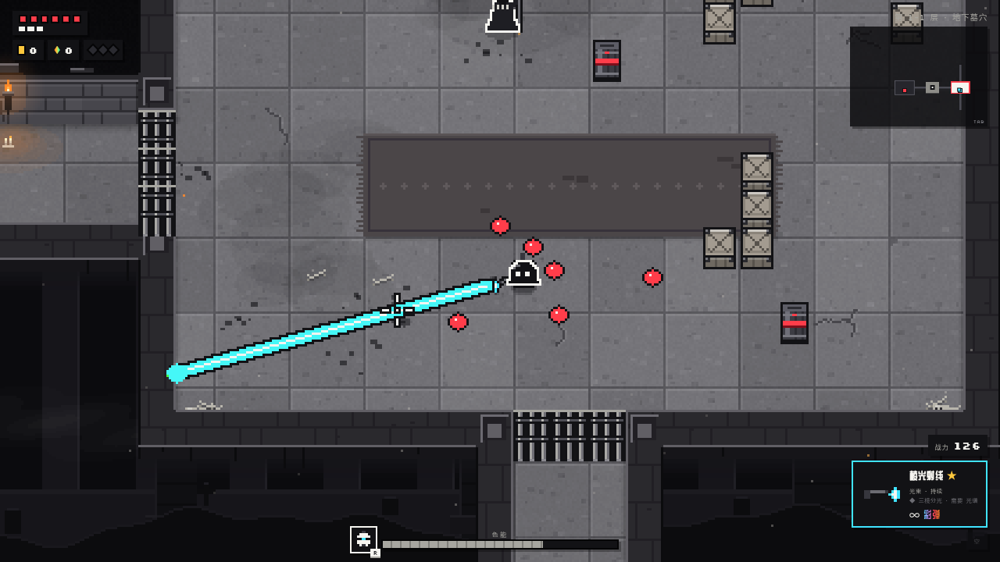

# Grisaille · 灰境·夺色

一款黑白灰像素风的地牢 roguelike，打开浏览器就能玩。世界的颜色被一块活着的棱镜吞掉了，你要一路打下去，把颜色夺回来。

**▶ 在线试玩：https://grisaille.pages.dev/**（需要键盘和鼠标）



[English](#english)

## 特色

- **8 层地牢**：地下墓穴、下水道、机关大厅、虚空四个区域，每个区域两层，每层尽头有一个守卫首领。
- **吸色武器**：32 把武器分四类（弹匣、蓄力、近战、光束），力量都来自打怪吸收的「色能」。弹匣换弹时吸色，打出彩弹；蓄力满后继续吸色，进入过载；近战吸色更快，还能斩出彩刃；光束不用换弹，有色能时伤害更高。
- **符文构筑**：63 枚符文、10 个流派（集齐 3 / 5 / 7 枚觉醒）、34 种共鸣组合。
- **35 种敌人**：每种都有一眼能认出的招数，第一次遇到时会提示怎么打。
- **跨局成长**：精英和首领掉落的「色晶」死后也会保留，回营地研究台解锁武器、角色、符文包和天赋。
- **难度与诅咒**：4 档难度；首次通关后，还能叠加 7 种诅咒挑战自己。
- **在线排行榜**：所有难度一张总榜，按综合分排名。
- 中文 / English 双语，支持全屏，屏幕震动可调。

## 操作

| 按键 | 作用 |
|---|---|
| WASD | 移动 |
| 鼠标 / 左键 | 瞄准 / 攻击（按住连发或蓄力） |
| 空格 | 冲刺 |
| F | 色能满后释放「夺色」 |
| Q | 切换武器 |
| E | 拾取、开箱、对话 |
| R | 角色技能 |
| TAB | 大地图（不在战斗中时，点击去过的房间可以直接传送） |
| ESC | 暂停 / 查看构筑 |
| M | 静音 |

## 本地运行

不需要安装任何东西：下载仓库后，用浏览器直接打开 `index.html` 就能玩。排行榜需要服务器，本地打开时不可用。

打包成一个独立的 HTML 文件：

```bash
python3 build.py      # 输出 dist/index.html
```

## 排行榜与部署

线上版部署在 Cloudflare Pages：排行榜接口用 Pages Functions 实现，数据存在 D1 数据库里。

- `functions/api/run.js`：每局开始时发一张一次性凭证
- `functions/api/score.js`：结算时核对凭证、用时和数据范围，由服务器重新算分后入榜
- `functions/api/top.js`：返回前 50 名

综合分 = 到达层数 × 1000，通关再加 2000，外加通关速度加分和每次击杀 2 分；最后乘难度倍率（0.6 / 1 / 1.4 / 1.8），每层诅咒再加 10%。

连同排行榜一起在本地运行（需要 Node.js）：

```bash
python3 build.py
npx wrangler d1 execute grisaille-lb --local --file schema.sql
npx wrangler pages dev
```

部署你自己的一份：

```bash
npx wrangler login
npx wrangler d1 create grisaille-lb      # 把输出的 database_id 填进 wrangler.toml
npx wrangler d1 execute grisaille-lb --remote --file schema.sql
npx wrangler pages project create <项目名> --production-branch main      # 同时把 wrangler.toml 里的 name 改成这个名字
python3 build.py && npx wrangler pages deploy --branch main
```

## 代码结构

零依赖的原生 JavaScript + Canvas 2D。所有像素美术都由代码绘制，音效和音乐用 Web Audio 实时合成，仓库里没有图片或音频素材（字体来自 Google Fonts）。

`js/` 下的脚本按 `index.html` 里的顺序加载，共享全局变量：

| 文件 | 内容 |
|---|---|
| `core.js` | 数学工具、调色板、画布、输入、像素绘制、粒子 |
| `i18n.js` | 中英文文本、设置与存档 |
| `audio.js` | 音效与氛围电子音乐合成 |
| `world.js` | 地图生成、地形、碰撞、寻路 |
| `combat.js` | 符文、共鸣、伤害结算、特效 |
| `player.js` | 角色与技能、武器和四类吸色机制 |
| `enemies.js` / `bosses.js` | 敌人与多阶段首领 |
| `story.js` | 剧情文本、NPC、日记残页、对话 |
| `scenery.js` | 关卡背景、氛围效果、标题画面与像素 logo |
| `ui.js` | HUD、小地图、符文卡、菜单、结算 |
| `rooms.js` | 特殊房间：试炼、铁匠铺、命运轮盘、双泉、禁书库 |
| `meta.js` | 色晶、营地研究台、目标 |
| `lb.js` | 排行榜前端 |
| `main.js` | 流程、房间、奖励、拾取、渲染、主循环 |

## 许可

[MIT](LICENSE)

---

## English

**Grisaille** is a greyscale pixel-art dungeon roguelike that runs in the browser. A living prism has drained the world of colour; fight your way down and take it back.

**▶ Play: https://grisaille.pages.dev/** (keyboard and mouse)

- 8 levels across 4 biomes, each ending in a guardian boss
- 32 weapons in four classes (magazine, charge, melee and beam), all powered by colour absorbed from foes
- 63 runes, 10 schools and 34 resonance combos
- 35 enemy types, colour crystals that persist between runs, and a camp research table for unlocks
- 4 difficulties, plus 7 stackable curses after your first win
- Online leaderboard (Cloudflare Pages Functions + D1)
- English and Simplified Chinese

**Controls:** WASD move · mouse aim, left-click attack · Space dash · F unleash colour · Q swap weapon · E interact · R skill · TAB map · ESC pause · M mute

**Run locally:** open `index.html` in a browser, no install needed (the leaderboard needs the server). `python3 build.py` bundles everything into `dist/index.html`. The leaderboard and Cloudflare deployment commands are in the Chinese section above.

No dependencies: plain JavaScript and Canvas 2D. All art is drawn in code and all sound is synthesised with Web Audio.

License: [MIT](LICENSE)
